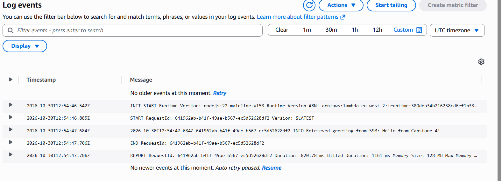

# Moringa AWS DevOps Capstone Project 4
## Automated and Governed Cloud Platform

This project demonstrates Infrastructure as Code (IaC), runtime configuration from AWS Systems Manager Parameter Store, an AWS Lambda function, AWS Step Functions, and automated deployment through a GitHub-connected pipeline.

## Architecture

1. **AWS CDK** defines the infrastructure in TypeScript.
2. **AWS Systems Manager Parameter Store** stores the greeting at `/app/config/greeting`.
3. **AWS Lambda** retrieves the parameter at runtime using the AWS SDK.
4. **AWS IAM** grants the Lambda function permission to call `ssm:GetParameter` for the specific greeting parameter.
5. **AWS Step Functions** starts the workflow, invokes the Lambda function, retries eligible failures, and handles errors.
6. **GitHub and AWS CodePipeline/CDK Pipelines** will automate deployment from the `main` branch once configured.

## Project Structure

- `bin/` — CDK application entry point.
- `lib/` — CDK infrastructure definitions.
- `lambda/` — Lambda function source code.
- `test/` — CDK test files.
- `cdk.json` — CDK application configuration.
- `package.json` — Node.js dependencies and scripts.

Generated files such as `cdk.out/`, `node_modules/`, and `lambda-bundle/` are excluded from Git.

## Configuration

The CDK stack creates this SSM String parameter:

- **Name:** `/app/config/greeting`
- **Initial value:** `Hello from Capstone 4!`

The Lambda function reads the parameter name from the `PARAMETER_NAME` environment variable and retrieves its value at runtime. Its IAM policy grants `ssm:GetParameter` access to that parameter.

## Step Functions Workflow

The workflow contains these states:

1. `StartWorkflow` — starts the workflow.
2. `ReadGreetingFromSSM` — invokes the Lambda function, with retry and error-handling configuration.
3. `HandleGreetingFailure` — handles the caught failure after retries.

## Local Validation

From the repository root, run:

```powershell
npm.cmd install
npm.cmd run build
npx.cmd cdk synth
```

These commands install dependencies, compile the TypeScript application, and synthesize the CloudFormation template. Synthesis does not deploy the infrastructure.

## Deployment Pipeline

The planned deployment pipeline will connect this GitHub repository to AWS and deploy changes pushed to `main`. The source connection, pipeline deployment, and successful execution must be verified in AWS before this section can be considered complete.

## Validation Evidence

Add screenshots from the AWS console after the deployment and workflow tests succeed.

### 1. Successful Pipeline Execution

_Status: Pending pipeline setup and successful execution._

Save the screenshot under `screenshots/codepipeline-success.png` and embed it here:

<!-- Add screenshot:  -->

### 2. Successful Step Functions Execution

_Status: Pending deployment and manual execution._

Save the screenshot under `screenshots/step-functions-success.png` and embed it here:

<!-- Add screenshot:  -->

### 3. Lambda CloudWatch Logs

_Status: Pending deployment and Lambda invocation._

Save the screenshot under `screenshots/lambda-cloudwatch-logs.png` and embed it here:

<!-- Add screenshot:  -->

## Repository

GitHub: https://github.com/fanuelodipo-cell/moringa-aws-devops-capstone-4

## Completion Checklist

- [x] CDK infrastructure defined in TypeScript.
- [x] SSM parameter and Lambda function defined.
- [x] Least-privilege permission for reading the SSM parameter defined.
- [x] Step Functions workflow with retry and catch handling defined.
- [x] Local build and CDK synthesis successful.
- [ ] GitHub-triggered deployment pipeline deployed and verified.
- [ ] Step Functions workflow manually executed and verified.
- [ ] Lambda CloudWatch log evidence captured.
- [ ] Required screenshots added to this README.
